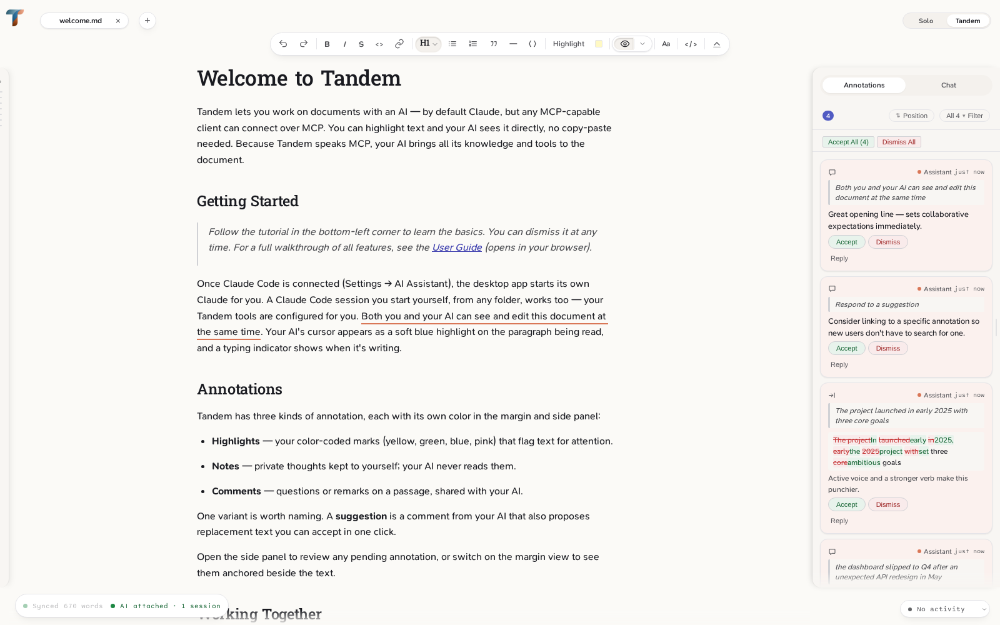

  <picture>
    <source media="(prefers-color-scheme: dark)" srcset="docs/assets/logotype-dark.png">
    
  </picture>

  
  
  

**An editor where you and an AI work on the same document at the same time.**

## Why I built this

At work I kept asking Claude to draft a report for me. I'd have it write into a scratch file in my Obsidian vault, and that file updated instantly. That much was great. But if I wanted a paragraph changed, or wanted to ask why a sentence was there at all, I was back to copying text into the chat window and pasting the answer out again. It was a one-way street. And Claude couldn't open a note for me either; I had to go find it myself.

So I built Tandem. I tell Claude to pull something up in Tandem, and then I just keep talking to it there: in the chat beside the document, or by commenting on a specific paragraph, or by highlighting a sentence and asking about *that* (it knows what I'm pointing at). It works the other way too. I can open any file in Tandem and Claude is already attached to it, with no session to start and nothing to paste in. If I want it to see the rest of that folder as well, Tandem offers to relaunch it there.

It started with reports, but it isn't really about reports. If you're copying text back and forth between a chat window and the document you're writing, that's what this is for.

One thing you need, though: an AI client running on your own computer, plus the subscription behind it. [Claude Code](https://claude.com/claude-code) is the default, and a Claude Pro or Max subscription includes it. Clients connect over [MCP](https://modelcontextprotocol.io), an open standard for letting an AI reach tools and files, so you can use others too. [Install](#install) below covers the setup, which is a wizard rather than a config file. Without a client connected, Tandem is still a local editor (open, edit, save) and nothing more.

  

*Your document on the left, the AI's comments and suggested rewrites as cards on the right. Accept, dismiss, or reply to ask for something different.*

## Who Tandem is for

- You're drafting something long (an essay, a report, a proposal, a design doc) and you want a second reader for tone and structure.
- You're reviewing what someone else wrote (a thesis chapter, a contract, a spec) and you want a faster pass.
- The AI wrote a draft and you have to decide what to keep.

I built Tandem for one person working on their own documents. Those three are examples rather than a boundary, and the kind of document doesn't change how any of it works: a contract behaves the same as an essay. The interface is English-only for now.

## Install

**[Download the installer for your platform →](https://github.com/bloknayrb/tandem/releases/latest)** Windows, macOS, and Linux. The desktop app bundles the editor, its server, and its own updates. Double-click a `.md`, `.markdown`, `.txt`, or `.html` file and it opens in Tandem.

Then connect your AI. Tandem opens a setup wizard the first time you run it. If [Claude Code](https://claude.com/claude-code) isn't installed it can install it for you in one click on all three platforms, and it writes the connection settings itself. You can reopen the wizard any time from **Settings → AI Assistant**. Two things before you start. **A Claude Pro or Max subscription includes Claude Code** (pay-as-you-go API billing works too). And **the Claude you use at claude.ai in a browser can't connect**, because a web page has no way to reach a file on your disk. The subscription alone doesn't do it: you need Claude Code, or Claude Desktop, installed locally as well.

Prefer a different AI? Any MCP-capable client can connect to the same endpoint. [docs/integrations.md](docs/integrations.md) covers what's supported and what's untested. Claude Desktop is set up by the same wizard on all three platforms; [Cowork](#cowork), its local agent mode, is not supported in this version.

<b>System requirements</b>

Windows 10 version 22H2 or Windows 11; macOS 12 (Monterey) or later; Linux with glibc 2.31 or later (Ubuntu 20.04+, Debian 11+, Fedora 34+). On Windows the first launch may show a "Windows protected your PC" warning, which lasts until the installer's signing certificate accumulates SmartScreen reputation. [The troubleshooting entry](docs/troubleshooting.md#windows-smartscreen-warning) has how to dismiss it.

<b>Install from npm instead</b>

`npm install -g tandem-editor` (you'll need Node.js 22.12.0 or newer), then run `tandem`. It starts the server and prints a `http://127.0.0.1:3479` URL that opens the editor in your browser, where the first-run wizard connects Claude. For a scripted setup with no prompts, run `tandem setup --apply` once first. This is mostly useful if you already have Node.js; otherwise I'd just use the desktop app.

<b>Real-time updates for hand-started sessions</b>

**How Claude starts matters.** Tandem talks to Claude over two independent connections: one lets Claude read and edit your document, the other tells it the moment you comment or send a chat message. Sessions Tandem launches for you, including the desktop app's **Relaunch Claude** button, get both and need no extra configuration.

