# User Guide

[Home](README.md) › [Using Tandem](maps/using-tandem.md)

A complete guide to using Tandem — from first launch to advanced workflows.

> **Scope:** Examples use Claude Code as the default AI, per [ADR-038](decisions.md#adr-038-mcp-first-integration-policy-claude-as-default-integration). The editor itself is AI-client-agnostic — any MCP-capable client connecting to `http://127.0.0.1:3479/mcp` gets the same MCP tools. The Claude-specific transports (channel push, auto-launcher) don't apply to other clients.

> **Setting up an AI integration rather than learning the editor?** Skip to [Working with Claude Code](#working-with-claude-code) for the Claude default, or see [Integrations → The MCP integration policy](integrations.md#the-mcp-integration-policy) for the generic MCP path.

**Contents:** [Overview](#overview) · [First launch](#first-launch) · [The editor](#the-editor) · [Working with documents](#working-with-documents) · [Annotations](#annotations) · [Reviewing annotations](#reviewing-annotations) · [Chat](#chat) · [Settings](#settings) · [Keyboard shortcuts](#keyboard-shortcuts) · [Working with Claude Code](#working-with-claude-code) · [Troubleshooting](#troubleshooting)

## Overview

Tandem lets you work on documents with an AI without the constant copy-paste. You open a document — an essay, a report, a proposal, a contract you're reviewing, or any prose — highlight the text you want to discuss, and the AI sees it directly. The AI can suggest rewrites, leave comments, and edit text alongside you in real time. Because the AI connects through [MCP](glossary.md#mcp), it brings all its knowledge, tools, and conversation context to the document — it's not working in isolation. Each [annotation](glossary.md#annotation) is a first-class object you can accept, dismiss, edit, or discuss. Edits to a Markdown or plain-text file — yours or the AI's — are written back to that file when you save, and automatically about once a minute while it has unsaved changes (see [Saving](#saving)). Opening a file just to read or annotate it never rewrites it.

Tandem runs as a local server with two surfaces: an **editor** where you read and edit documents, and an **MCP client** (Claude Code by default) where the AI connects via MCP tools. Changes sync instantly between them through [Yjs CRDT](glossary.md#ydoc-and-crdt) collaboration.

Tandem is available as a [desktop app](https://github.com/bloknayrb/tandem/releases/latest) (macOS, Linux, Windows) or as an [npm package](https://www.npmjs.com/package/tandem-editor) (`npm install -g tandem-editor`), which opens the same editor in your browser. The desktop app manages the server automatically; the npm install requires starting it from the terminal. Editing, annotations, chat and the integration wizard work the same in both. The desktop app adds what only a native shell can do: a system tray, native right-click menus and file dialogs, start-at-login, in-app log access, and automatic updates. Instructions below that apply to only one of the two say so.

## First Launch

On first run, Tandem opens `sample/welcome.md` automatically. Four tutorial annotations appear in the document — a highlight, a comment, a comment with replacement text, and a private note — so you have something to interact with immediately.

A **Getting started** checklist sits at the top of the window, above the document, with three things to try. Each one ticks itself off when you do it, in any order — there is no Next button:

1. **Accept or dismiss a comment from Claude** — one of the two tutorial comments, from the side panel or the margin view (`Ctrl+Enter` accepts the selected comment, `Ctrl+Shift+Enter` dismisses it). The highlight and the note are yours, so they have no Accept or Dismiss.
2. **Ask Claude something** — select text, click Annotate and send it to Claude, or type in the Chat panel. A private note doesn't count: Claude never sees it.
3. **Make an edit** — click in the document and type. Edits Claude makes, and suggestions you accept, don't count.

When all three are ticked the strip says "You're ready!" and closes itself a few seconds later (or click **Done**). The **×** dismisses it at any time. Either way it won't appear again (saved to localStorage); **Settings → Replay tutorial** brings it back. Items you've ticked stay ticked if you reload or restart before finishing.

**Tip:** Start the Tandem server before Claude Code. Having the AI connected before the tutorial means you'll see real responses when you ask a question with item 2.

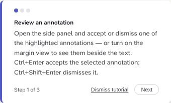

**On first run:** the integration wizard walks you through connecting Claude Code, in both the desktop app and the browser — there's no need to run `tandem setup` from a terminal. In the desktop app the server is already running; with the npm install, start it with `tandem` first. You can reopen the wizard any time from **Settings → AI Assistant**, or (desktop app only) the tray's "Setup AI Assistant" item.

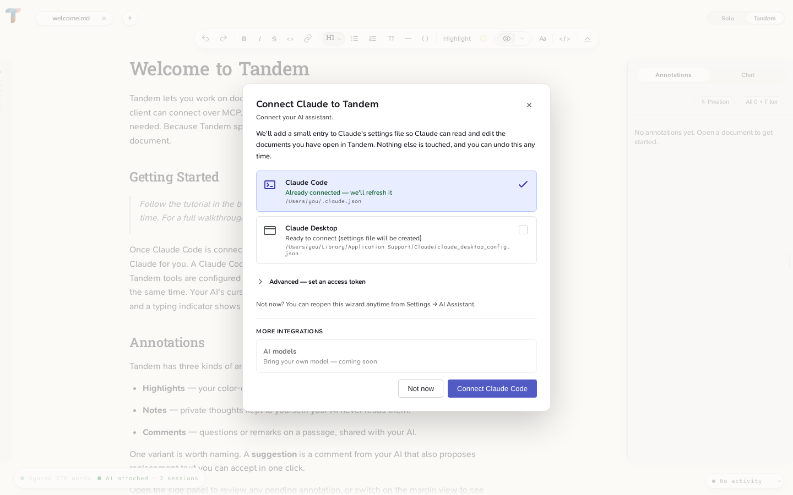

## The Editor

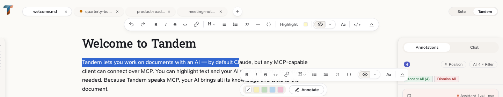

### Document Area

The main editing area is a rich text editor powered by Tiptap. You can type, select, format, and edit just like any document editor. When your AI is connected, its focus paragraph gets a subtle blue highlight so you can see where it is reading.

### Tab Bar

Open documents appear as tabs along the top. Each tab shows the file name, and a dot while there are unsaved changes. A read-only document shows **Review Only** in the status bar, and its tab's tooltip ends in "(read-only)".

- Switch tabs with `Ctrl+Tab` / `Ctrl+Shift+Tab` (in the desktop app; a browser keeps those keys for its own tabs), or jump straight to one with `Ctrl+1`–`Ctrl+9`
- Drag tabs to reorder them, or use `Alt+Left` / `Alt+Right`
- Double-click a tab title (or press `F2`) to rename the file inline
- Click the **+** button at the end of the tab bar to open a new file

### Formatting Toolbar

Select text to reveal formatting buttons: **Bold**, **Italic**, **Strikethrough**, **Code**, **Link** (see [Links](#links)), **Headings** (H1/H2/H3), **Bullet List**, **Ordered List**, **Blockquote**, and **Code Block**. Standard keyboard shortcuts also work (`Ctrl+B`, `Ctrl+I`, etc.). The toolbar wraps to a second row on narrow windows.

The persistent formatting bar (Settings → Appearance → **Show formatting bar**, or `Ctrl+Alt+F`) carries two extra controls the selection popup deliberately leaves out: **Undo** / **Redo**, and **Horizontal Rule** — inserting a rule while text is selected makes little sense.

The bar's **Display** menu (the `Aa` button) sets the text size and reading measure for the formatted editor without opening Settings. It changes the same settings as Settings → Appearance and Settings → Editor, so the two always agree. The Markdown source view keeps its own fixed size and width.

### Selection Popup

When text is selected, a floating popup appears with two parts:

- **Highlight swatches** — One-click highlighting in 4 colors (yellow, green, blue, pink), plus a "no highlight" swatch that clears an existing highlight.
- **Annotate** — Opens a small composer anchored to the selection. Type your text, then choose the audience:
  - **Note to self** (`Alt+Enter`) — A private note. Never sent to the AI. `Alt+Enter` always files a note, whichever button is primary.
  - **Send to your AI** (`Ctrl+Enter`) — An outbound comment. The AI sees the selected passage and your text, and can respond with annotations, chat messages, or both. The button is labelled with your configured assistant's name. `Ctrl+Enter` sends the *primary* action, which is the outbound comment by default.

The popup also includes a toggle to show or hide the formatting bar, and mirrors the bar's **Decorations** and **Display** menus so both stay reachable while the bar is hidden.

If you'd rather not see the popup at all, turn off **Settings → AI Assistant → Show floating selection toolbar**. The formatting bar still works; `Ctrl+Alt+M` (comment on selection) needs the popup, so it stops working while the popup is off.

### Slash Menu

Type `/` at the start of a line (or after a space) to open a block menu: Paragraph, Heading 1, Heading 2, Heading 3, Bullet list, Numbered list, Task list, Quote, Code block, Horizontal rule, and a 3×3 Table with a header row. Keep typing to filter by name. The menu also shows each command's short alias (`p`, `h1`, `h2`, `h3`, `ul`, `ol`, `todo`, `q`, `code`, `hr`, `3x3`) beside it. Most aliases filter too, but `3x3` does not — type "table" to find the table.

**Paragraph** is a reset rather than an insert: it turns the current block back into plain body text, lifting it out of a list or a quote. It is first in the list, so `/p` reaches it directly and pressing `Enter` on the unfiltered menu does nothing rather than inserting a heading you didn't ask for.

Use `↑` / `↓` to move, `Enter` to insert, `Esc` to close. The `/` and whatever you typed after it are removed when the command runs. The menu only opens on text you actually type, so clicking after an existing `/` won't summon it, and it stays out of the way while the find bar, command palette, or an annotation popup is open, or when the caret is inside a code block.

### Links

Select some text and click **Link** on the selection popup or the formatting bar to open a small link editor: type or paste the address in the `https://` field and click **Apply** (or press `Enter`), or **Cancel** to back out. With the caret in an existing link, the same button opens the editor on that link; clear the field and apply to remove the link. In the desktop app, right-clicking a link also offers **Edit Link…** and **Remove Link**.

Clicking a link to a web page opens it in your default browser. A relative link to another Markdown, plain-text or HTML file opens that file in a new Tandem tab, resolved from the current document's folder; a link that points outside that folder is refused, and so is a relative link in a document that hasn't been saved to disk yet.

### Collapsing Sections

Hover over a heading and a small chevron appears to its left. Click it to collapse everything under that heading, down to the next heading of the same or a higher level; click it again to expand. A collapsed heading keeps its chevron visible so you can find your way back. Collapsing is a personal view: it only hides the section on your screen, doesn't change the file, and isn't shared with the AI. Tandem remembers which sections you collapsed in each file (not in scratchpads or uploaded files).

### Right-Click Menus

**Desktop app only** — these are real OS menus. The browser build shows its browser's own menu in the document and nothing in the app chrome.

- **In the document:** Undo/Redo, Cut/Copy/Paste, **Paste as Raw Text** (`Ctrl+Shift+V`), and Select All. Right-clicking a link gives Open / Copy / Edit / Remove Link; right-clicking inside a table gives row and column submenus plus Merge Cells, Split Cell, and Delete Table. With text selected, three more items appear: **Ask AI about selection…**, **Comment to AI…**, and **Private Note…**. (On macOS, plain text keeps the native menu so Look Up and Services still work.)
- **On a tab:** Close, Close Tabs to the Left / Others / to the Right, Rename, Save or Save As…, View Markdown Source, Copy File Name, Copy Path, and Reveal in Finder / Show in File Explorer / Show in File Manager (macOS / Windows / Linux).
- **On an annotation card** (side panel or margin): Accept, Dismiss, Reply…, Edit…, **Send to Claude**, Copy text, and Remove (or Archive, for notes). The card's own button and the annotate popup use your configured assistant's name; this one OS menu item says "Claude" whichever model you have configured.

Right-clicking empty app chrome — rails, panel padding, the status bar — deliberately does nothing.

### Scroll Pill

The editor replaces the usual scrollbar with a slim pill in the right gutter. It fades in as your pointer approaches and flashes briefly whenever you scroll, so it stays out of the way while reading. Drag it to scrub through the document; it isn't a click-to-jump target, and it hides entirely when the document fits on screen. Turn it off in **Settings → Appearance → Scroll pill** to get the system scrollbar back.

### Outline Panel (left)

The left panel is the document outline: every heading in the active document, click to jump. A thin strip of tick marks beside it previews the document's shape even while the panel is collapsed. Toggle it with `Alt+Shift+Left`.

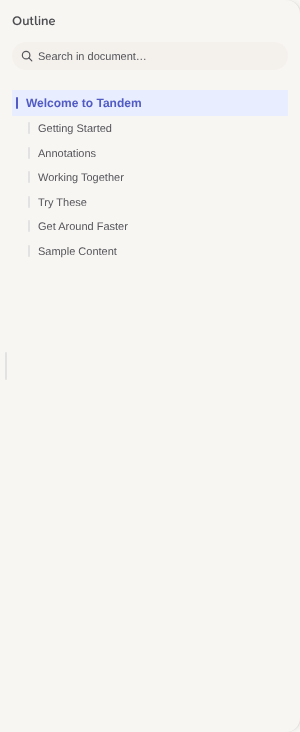

### Side Panel (right)

The right panel toggles between two views. Toggle the panel itself with `Alt+Shift+Right`.

Either rail can be resized by dragging the thin strip between it and the document. The strip is also keyboard-operable: tab to it and use the arrow keys.

**Annotations** — Lists all annotations with filtering by type, author, and status. Each card shows a preview of the annotated text, the annotation content, author badge, and timestamp. Bulk **Accept All** / **Dismiss All** buttons appear when multiple annotations are pending. When filters are active, bulk actions only affect the filtered subset.

**Chat** — Freeform messaging with your AI. See the [Chat](#chat) section for details.

### Status Bar

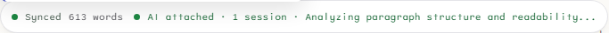

The floating pill at the bottom-left shows the following — it stays faint until you hover or focus it:

- **Connection state** — Green when connected, with reconnect attempt count and elapsed time during disconnects. A prominent banner appears once the connection has been down for 30 seconds (adjustable; see [Connection lost](#server-unavailable-or-weve-lost-the-connection-to-the-tandem-server)).
- **Word count** — Click to cycle through words, characters, sentences, and paragraphs.
- **Save state** — "Saving…" while a write is in flight, then "Saved HH:MM".
- **Review Only badge** — Appears when the active document is read-only (an uploaded file, any HTML file, or the changelog opened via View Changelog).
- **Held count** — In Solo mode, how many of your comments and replies are being withheld.
- **AI connection** — Who is attached. **Tandem's Claude** means the Claude session Tandem started for you is running; Tandem wakes it when you send a message, and it shows "Tandem's Claude is working…" while it is mid-turn. **AI attached** means something else is connected — a Claude Code session you started, Claude Desktop, or another MCP client — which sees your messages only when it checks in, unless it set up notifications. **AI not connected** means nothing is. Beside **Tandem's Claude**, a **green dot** means Tandem has matched a live connection to its own Claude, and a **hollow ring** means it can't confirm which connection that is (with the plain config entry `tandem setup` writes, the ring is the normal look). Beside **AI attached**, a green dot means a live session is connected, and a hollow ring usually means a session that closed without disconnecting. **· 2 sessions** after the label counts the connections Tandem can see. It's an estimate: a session that just closed still counts for about a minute, one Claude connected two ways counts twice, and clients on the newest MCP protocol revision aren't counted. [Troubleshooting](troubleshooting.md#i-sent-a-chat-message-or-left-a-comment-and-nothing-happened) has the details. If Tandem's own Claude has stopped while something else is attached, a separate **Tandem's Claude** button says why (not running, needs sign-in, or can't start) and offers the fix (it leaves any Claude you started yourself alone).
- **Tandem's Claude standby** — When Tandem's Claude isn't running by your choice, the pill says so instead of reporting a fault: **Tandem's Claude is off** (you turned it off, or chose **Off** in Settings), **Tandem's Claude hasn't started** (it is set to wait until you click Start), or **Tandem's Claude stopped (idle)** (it stopped after the idle time you chose; its conversation resumes when it starts again). In these states — unless you are in Solo or another AI is connected — the pill is a **Start Tandem's Claude** button: click it and the pill shows **Starting Claude…** until it is running. Sending a chat message also starts it — see [Tandem's Claude in chat](#tandems-claude-in-chat).
- **Working-folder pill** — Appears when the AI's working directory has drifted from the document you have open.

Your display name is set in **Settings → Collaboration**. The Solo / Tandem toggle (`Ctrl+Shift+M`) lives in the title bar at the top of the window, not the status bar. See [Solo / Tandem Mode](#solo--tandem-mode).

### Toast Notifications

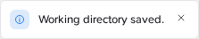

Annotation failures and save errors surface as dismissible toast notifications at the bottom of the screen. Toasts auto-dismiss by severity (errors linger longest) and show a count badge when the same message repeats.

### Activity Tray

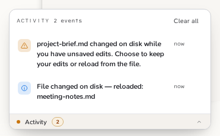

Toasts disappear; the **Activity** tray keeps them. Its pill sits at the bottom-right of the window and reads **No activity** or **Activity** with a count. Click it to open the list of recent saves, errors and integration events, newest first, each with how long ago it happened and a ×2, ×3… badge when the same event repeats. A failed save carries a **Retry** button. Dismiss a row with its ×, or empty the list with **Clear all**; click outside the tray or press `Esc` to close it. The list survives a reload of the window, holds the most recent 50 events, and drops informational events after five minutes.

### Brand Menu

The Tandem logo at the top-left of the title bar opens the brand menu:

- **Color scheme** — swatches for **Match system**, **Light**, **Dark** and **Warm**. This is the same setting as Settings → Appearance → Theme, so the two always agree. Warm is a paper-toned light theme.
- **Settings…** (`Ctrl+,`)
- **Keyboard Shortcuts** (`?`)

In the desktop app, a dot on the logo means an update is ready; opening Settings clears it.

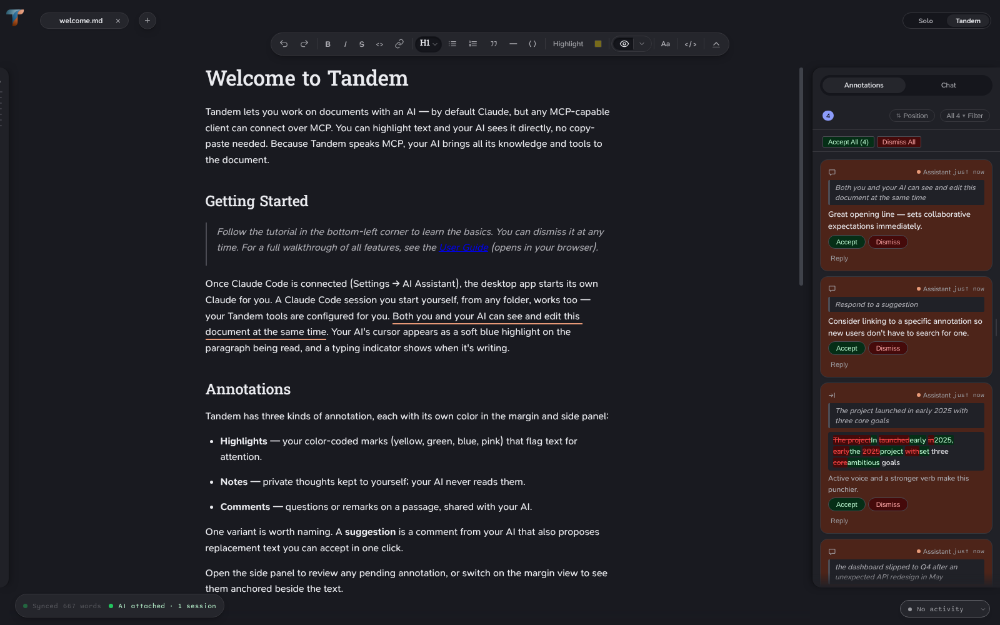

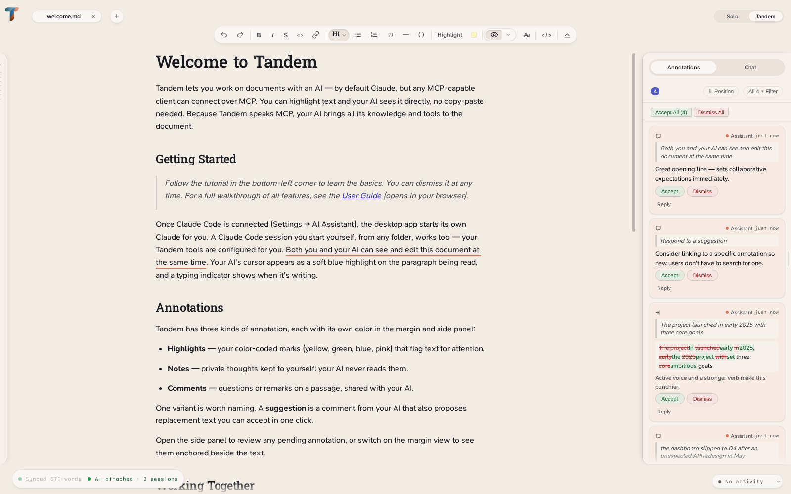

### Help Modal

Press `?` (or `Ctrl+/`) at any time, or choose **Keyboard Shortcuts** from the brand menu, to open the keyboard shortcuts reference. Press `?` or `Esc` to close it.

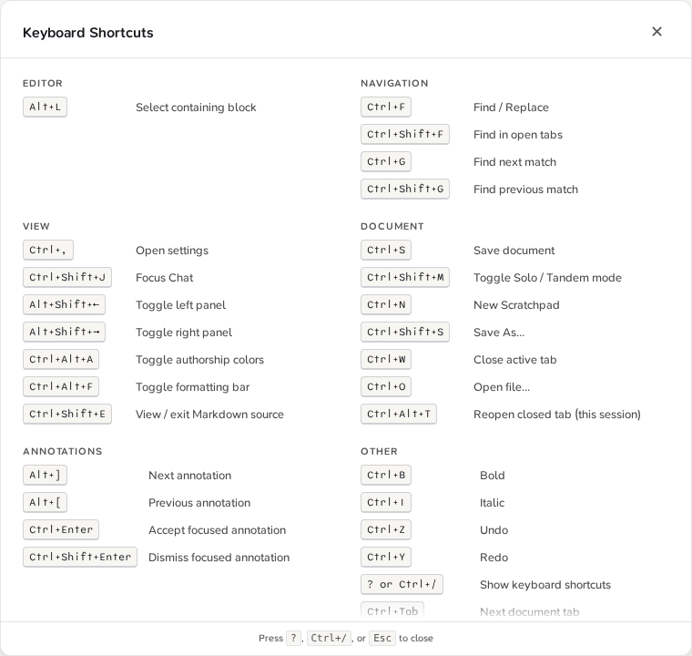

### Banners

A few messages appear as a banner across the top of the window rather than as a toast, because they need an answer or stay true until something changes:

- **Connection lost** — "We've lost the connection to the Tandem server…", with **Retry now**. See [Connection lost](#server-unavailable-or-weve-lost-the-connection-to-the-tandem-server).
- **Server restarted — refreshing documents** — shown briefly while open tabs reconnect after the Tandem server restarts.
- **A file changed on disk** — offers **Keep my edits** or **Reload from file**. See [When a file changes on disk](#when-a-file-changes-on-disk).
- **Update available** (desktop app) — "Tandem v… is available." with **Restart to install**. The app checks when it starts and every eight hours after that; the tray's **Check for Updates** checks on demand. Dismiss the banner with its × (opening Settings also clears it) to install later.
- **Update didn't finish** (desktop app) — "Tandem may not have finished updating — it restarted on the previous version." with **Check for updates**, which looks for the update again.

### System Tray (desktop app)

The desktop app puts a Tandem icon in the system tray (the menu bar on macOS). Closing the window hides it to the tray rather than quitting, so the server — and any Claude Tandem started for you — keeps running; click the tray icon to bring the window back. Its menu has:

- **Open Editor** — show the window.
- **Setup AI Assistant** — show the window and open the integration wizard.
- **Check for Updates** — check now and tell you the result.
- **About Tandem** — the version number.
- **Quit** — close Tandem completely, including the server.

On Linux without tray support, there is no icon and closing the window quits Tandem.

## Working with Documents

### Opening Files

You can open a file a few ways:

**Drag-and-drop** — Drag a file from your file manager onto the editor. A dashed border appears as a drop indicator.

**Recent files** — Click **+** in the tab bar to see recently opened files; type to filter, then click one to open it.

**Browse or upload** — Click **+** in the tab bar, then **Browse files…** (or press `Ctrl+O`). On desktop this opens a native file picker for real (write-capable) editing. In the browser build it opens an **Open File** dialog instead. Its **Browse…** button uploads a copy of a file: [uploaded files](glossary.md#upload) get a synthetic `upload://` path and are always read-only — `Save` preserves the session (annotations) but cannot write back to disk. To work on the file itself, use the dialog's path field (below). The same dialog also lists your **Recent** files and your **Saved sessions** (below), which open the real file on disk.

**Open by path (browser build)** — In the **Open File** dialog, type or paste the full path of a file on this computer (for example `/Users/you/notes.md` or `C:\Users\you\notes.md`) and click **Open** or press Enter. This opens the real file on disk, not a read-only upload: Markdown and text files are editable, and HTML files open read-only as they do everywhere. If the path is wrong or the file is not a supported format, the dialog stays open and says why.

**New scratchpad** — Click **+**, then **New scratchpad** (or press `Ctrl+N` in the desktop app; a browser keeps that key for itself). See [Scratchpads](#scratchpads).

### Saved Sessions (browser)

Tandem keeps a saved session for each file you have had open: its editing state and its annotations, so they come back the next time the file opens. In the browser build, the **Open File** dialog's **Saved sessions** section (click it to expand) lists them, each with its folder, when you last had it open and how many annotations it holds. Click a row to reopen that file. Click a row's **×** and then **Delete** to discard that file's saved session, or **Clear all…** and confirm to discard every one. Deleting can't be undone: the annotations stored with it are gone, though the file itself is untouched.

### Scratchpads

A [scratchpad](glossary.md#scratchpad) is a Markdown document that isn't tied to a file — somewhere to draft, paste or think before you decide where the text belongs. To keep one, use **Save As** (`Ctrl+Shift+S`): it becomes an ordinary file, in the same tab.

Until then, a scratchpad lives only in this window, so Tandem guards it in two ways:

- **Close warning** — closing a scratchpad tab that has text in it asks "This scratchpad has unsaved content that will be lost. Close it anyway?". In the browser, closing or reloading the Tandem tab while a scratchpad has text in it triggers the browser's own leave-page warning.
- **Recovery** — as you type, Tandem keeps a copy of a scratchpad's text in this browser's (or the desktop app's) local storage. If Tandem, the window or the computer goes away without the scratchpad being saved or closed, the next new scratchpad you open starts with that text. Only the text comes back; annotations on a scratchpad are not recovered. Closing a scratchpad and confirming the warning discards its copy.

### Supported Formats

- **Markdown** (`.md`) — Full read-write support. Your content round-trips exactly; some *formatting style* is canonicalized on the first save. See [Markdown formatting](#markdown-formatting) below.
- **Plain text** (`.txt`) — Full read-write support. One behaviour differs from Markdown:
  see [Line breaks in plain text](#line-breaks-in-plain-text) below.
- **HTML** (`.html`, `.htm`) — Read-only. It opens for reading and annotating, and the file is never written back: HTML is the one supported format with no save path at all, so it opens read-only rather than accepting edits it would silently drop on tab close.

**Word (`.docx`) isn't supported in this version.** Word support wasn't reliable enough for serious work, so it has been [taken out of the app for now](glossary.md#docx-support), and a `.docx` is refused with a message saying so. To work on a Word document, save a copy from Word as Plain Text (`.txt`) to edit it, or as Web Page (`.html`) to review it read-only, and open that.

### Line breaks in plain text

In a Markdown document a line break inside a paragraph and a break *between* paragraphs are
different things, and the file records which is which. **A plain-text file has only one
kind of line break.** So in a `.txt` document — or any file Tandem treats as plain text,
which is everything that is not `.md` — pressing **Shift+Enter** starts a new
paragraph rather than adding a break inside the current one, and a pasted line break does
the same.

This is not a limitation working around itself; it is what keeps the document stable.
The bytes Tandem writes are identical either way, so a break inside a paragraph would come
back as two paragraphs the next time the file was opened — the document quietly changing
shape between sessions. Tandem makes the choice up front instead, so what you see now is
what you get back.

For the same reason, a heading in a plain-text document joins its lines with a space
rather than splitting, and the AI's `tandem_edit` refuses a line break in a plain-text
document and is asked to append a block instead.

### Markdown Formatting

Tandem stores your document as structure, not as source text, so saving re-writes the
file from that structure. **What you wrote is preserved. How you wrote it may be
normalized** — once, on the first save. After that the file holds still.

Nothing in this list changes how the document renders in any viewer. These are the
things that do change:

- **Marker style.** Setext headings (`Title` over `=====`) become `# Title`; `*` bullets
  become `-`; `_em_` becomes `*em*`; `1)` becomes `1.`; `~~~` fences become backtick
  fences; indented code becomes fenced; `***` becomes `---`; runs of blank lines collapse
  to one.
- **Tables.** Column alignment (`:---`, `:-:`, `---:`) is preserved, but hand-aligned
  cell padding is not — cells are written compactly rather than padded to the widest
  value in the column. That is deliberate: with padded cells, editing one word reflows
  every row of the table.
- **Code spans.** Padding spaces inside a fence, and fences longer than they need to be,
  are trimmed to the shortest form that still works. A code span wrapped across two
  source lines comes back on one.
- **Escapes.** A literal backtick, a bracketed word matching a link definition, and an
  `@` before something host-shaped all keep their backslash. Tandem keeps an escape
  wherever removing it could change what the line means.
- **Emphasis nesting.** Where two styles cover exactly the same words — `~~**both**~~` —
  the order can come back swapped (`**~~both~~**`). Markdown records no trace of which
  was opened first. Where the two cover different spans, the nesting is preserved.

Everything else is written back as you left it: YAML and TOML frontmatter (fences and
all), loose vs tight list spacing, ordered-list start numbers, footnote and reference
definitions, raw HTML blocks, and your file's line endings — a CRLF file stays CRLF, and a
classic-Mac file with bare carriage returns stays that way too.

If a save ever looks wrong, the original is recoverable. Tandem copies the file's bytes
verbatim before its first write to it in a session; see
[troubleshooting → Recovering a previous version](troubleshooting.md#recovering-a-previous-version-of-a-document).

### Multi-Document Tabs

Each open file gets its own tab and its own collaboration room. Tabs scroll horizontally when they overflow. Reorder tabs by dragging or with `Alt+Left` / `Alt+Right`.

### Saving

Press `Ctrl+S` to save the active document to disk. Your AI can also save via `tandem_save`. A dot on the tab title indicates unsaved changes — edits, yours or the AI's, that haven't been written to the file yet. Saves are atomic (write to temp file, then rename) to prevent partial writes.

**Autosave.** You don't have to remember `Ctrl+S`. Every 60 seconds Tandem writes each open Markdown (`.md`) or plain-text (`.txt`) file that has unsaved changes back to disk, and it does the same once more when Tandem shuts down normally. A file you only opened to read or annotate is never rewritten. Some documents are never autosaved:

- read-only documents, including every HTML file and the changelog opened from Settings;
- files uploaded in the browser build, which have no file on disk to write to;
- scratchpads, which have no file until you use **Save As** — see [Scratchpads](#scratchpads);
- a file whose [disk-change banner](#when-a-file-changes-on-disk) is waiting for your answer;
- a file that is [read-only on disk](#read-only-files), until you choose to overwrite it.

Separately from the file itself, Tandem saves each open document's editing state and annotations every 60 seconds, so a restart (or a crash) brings your tabs back where you left them. If that state held edits that never reached the file, the document reopens with a banner asking whether to keep them; see [When a file changes on disk](#when-a-file-changes-on-disk). Before Tandem first writes to a file in a session, it keeps a copy of the file as it was — see the note under [Markdown Formatting](#markdown-formatting).

### When a File Changes on Disk

If another program changes a file you have open — a git checkout, a sync service, another editor — Tandem notices. If you have no unsaved edits in that document, it simply reloads the new version from disk, and your annotations stay attached to their text where that text still exists.

If you *do* have unsaved edits, Tandem won't choose for you. A banner at the top of the document says the file changed on disk while you have unsaved edits, and offers:

- **Keep my edits** — keep what's in the editor. Your next save overwrites the changes on disk.
- **Reload from file** — load the version on disk and discard your unsaved edits.

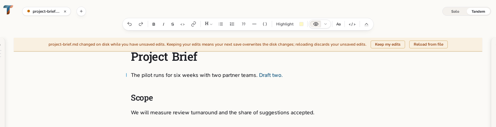

Until you answer, autosave leaves that document alone, and while the disk holds changes you haven't chosen to discard, `Ctrl+S` won't write over them either — so neither version is lost by accident. The same banner appears when Tandem restores unsaved edits from your last session ("Unsaved edits for … were restored from your last session"), asking whether to keep them or reload fresh from the file. For a format Tandem can't write back to disk, keeping your edits keeps them in this session only, and the banner says so.

### Read-only Files

If a file is marked read-only on disk (`chmod 444` on macOS and Linux, or **Read-only** ticked in the file's Properties on Windows), Tandem still opens it for editing, but it asks before it writes over the file. The first time a save is due, by autosave or `Ctrl+S`, Tandem leaves the file alone and shows a banner saying it is read-only and your edits haven't been saved:

- **Overwrite** (macOS and Linux) — save your edits into the file anyway. The file stays read-only afterwards, and Tandem doesn't ask again while the document stays open, unless another program changes the file in the meantime.
- **Not now** — keep editing without saving. Autosave stops asking; pressing `Ctrl+S` asks again.

A read-only file you haven't changed is never touched, and pressing `Ctrl+S` on it does nothing. On Windows there is no **Overwrite**: clear **Read-only** in the file's Properties, then save. Your AI cannot answer the banner for you; `tandem_save` reports that the file is read-only and leaves the choice to you. Closing the tab asks first, and if you close it anyway Tandem keeps the unsaved edits and reopens the file the next time it starts.

## Annotations

Annotations are how feedback — yours and your AI's — shows up in the document. There are three types, each with distinct visual styling:

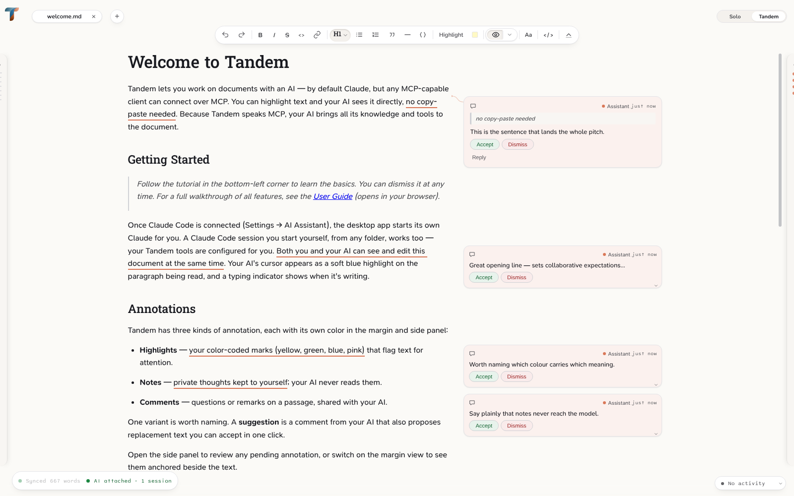

The shot above shows the optional **margin view** (Settings → AI Assistant), where cards sit beside the text they reference rather than in the side panel.

### Highlight

Colored background on the annotated text. User-only — the AI never creates highlights. Choose from 4 colors (yellow, green, blue, pink) via the selection popup's swatches. Use highlights to mark notable passages — green for good, yellow for problems, pink for style/tone.

### Comment

Dashed underline on the annotated text. Comments are the shared channel: you create them to send observations or questions to your AI, and it creates them to give feedback on your text. The comment text appears in the side panel card.

The AI's comments may carry a **replacement suggestion** (`suggestedText`) — a proposed text change. The side panel card shows a diff view: the original text in red with strikethrough, an arrow, and the replacement text in green. When a reason is provided, it appears below the diff. Accepting the comment applies the text change automatically. Suggestions are AI-only — your own comments are plain text; if you want a rewrite, ask for one in the comment and the AI responds with a suggestion you can accept.

### Note

A private note to yourself. Notes are never sent to the AI — it cannot read them through any MCP tool or event ([ADR-027](decisions.md#adr-027-annotation-system-redesign--audience-based-model)). Use them for personal reminders while you work. A note can later be **promoted** to a comment if you decide the AI should see it.

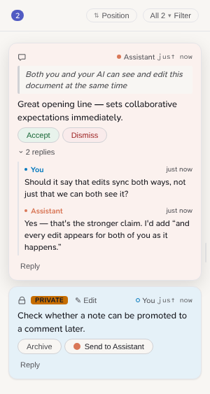

### Creating Annotations

Select text in the editor to reveal the selection popup. Click a highlight swatch for a highlight, or click **Annotate**, type your text, and choose **Note to self** (private) or the send button (an outbound comment — it carries your assistant's name).

### Editing Annotations

Click the **✎ Edit** button on any pending annotation card to edit its text. For a comment with replacement text, a second textarea appears for the proposed replacement.

Click **Save** to apply or **Cancel** to discard. Edited cards show "(edited)" with a timestamp. Only pending annotations can be edited — accepted or dismissed annotations are immutable.

## Reviewing Annotations

### One at a Time

Each annotation card in the side panel has **Accept** and **Dismiss** buttons. Accepting a comment with replacement text applies the text change. Accepting other annotations simply marks them as resolved.

### Undo

After accepting or dismissing, the resolved card briefly offers an **Undo** action. For accepted comments with replacement text, undo atomically reverts both the text change and the annotation status.

### Keyboard Review

Annotations can be reviewed without leaving the keyboard:

| Key | Action |
|-----|--------|
| `Alt+]` | Jump to next annotation |
| `Alt+[` | Jump to previous annotation |
| `Ctrl+Enter` | Accept the selected annotation (or the first pending one if none is selected) |
| `Ctrl+Shift+Enter` | Dismiss the selected annotation (or the first pending one) |
| `Escape` | Deselect the current annotation |

You can also enable the **margin view** (Settings → AI Assistant → "Margin annotation view") to see annotation cards beside the text they reference, in addition to the side panel list.

The margin adapts on two independent axes, and it helps to know which one you are seeing. **When the window is narrow**, the whole margin steps down — from full-width cards, to a narrow track showing a one-line teaser without the action row, to a bare tick mark, to nothing at all. **When cards are crowded** — too many anchored too close together — individual cards shrink to a one-line summary but **keep** their Accept/Dismiss buttons, so a shrunken card in a full-width margin is still actionable.

Either way, click a card to expand it while it's selected, or click its chevron to keep it expanded even after you select something else. Cards also widen to use empty margin space when you collapse or narrow a side rail.

### Bulk Actions

**Accept All** and **Dismiss All** buttons appear in the side panel header when multiple annotations are pending. A confirmation step is required before executing. When filters are active, bulk actions only affect the filtered annotations (e.g., "Accept 3 of 12 pending?").

### Solo / Tandem Mode


The title bar includes a **Solo / Tandem** toggle (`Ctrl+Shift+M`).

- **Tandem** (default) — everything flows both ways: the AI's annotations appear as they arrive, and the comments and replies you write are visible to it.
- **Solo** — the comments and replies **you** author are withheld from the AI until you switch back. **Chat and document edits are not affected in either direction**: your chat messages still reach the AI, and it can still read the document, answer, and edit. Solo holds annotations and replies, not the conversation.

**Solo is a one-way hold, and it is worth knowing which way.** The half the server enforces is outbound: since v0.19.0 nothing you write reaches the AI while you are in Solo. Each held item shows an amber **Held** pill, and the status bar shows a running count of what is being withheld. Switching back to Tandem releases the whole set at once — the AI picks them up on its next check, and a one-time nudge wakes a push-connected session to look.

The inbound half is **cooperation, not enforcement**. Both `tandem_checkInbox` and `tandem_status` report the current mode, and Tandem's bundled skill asks the AI to hold off on new annotations while you are in Solo — but nothing hides an annotation it creates anyway, and the document text and your current selection stay readable to it throughout. Solo means "the AI won't hear from me", not "the AI can't see me". (#1779 is the issue that corrected this section; it is closed. The absence of an inbound mechanism is a design fact, not an open bug.)

If you would rather not see the annotation list at all while you write, **Settings → Collaboration → Hide side panel in Solo mode** (on by default) collapses the right rail whenever you enter Solo and restores it when you return to Tandem.

**Exactly what the Solo hold covers.** Held comments and replies are withheld from every surface that sends them to the AI:

| Surface | Held in Solo? |
|---|---|
| `tandem_checkInbox` (what Claude is told) | Yes |
| `tandem_getAnnotations` (Claude reading the annotation list) | Yes |
| Real-time push — the built-in Monitor watch, the plugin monitor, the channel shim, and the wake-up Tandem sends its own Claude | Yes — annotation events only; chat messages always deliver |
| `tandem_exportAnnotations` (generating a review report) | Yes — the export reports how many items it withheld, so the report never reads as complete when it isn't. (This was previously exempt, on the reasoning that an export is an explicit "give everything" action. It isn't: only the AI can invoke this tool, so the "explicit action" was always the AI's, not yours.) |
| `tandem_getTextContent`, `tandem_getContext`, `tandem_search` | Not applicable — these return document text only, never annotation records |

Personal **notes** are private in both modes and are never surfaced to the AI through any tool ([ADR-027](decisions.md)).

Use **Solo** during focused writing to avoid interruption, or when you want to mark up a draft without the AI reacting to each comment. Switch to **Tandem** when you're ready — everything held is released at once.

## Chat

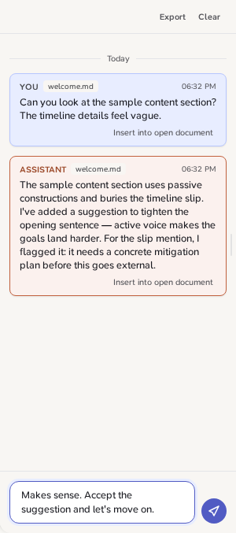

Toggle between the **Annotations** and **Chat** views using the tabs at the top of the side panel.

### Sending Messages

Type in the input box and press `Enter` to send. Messages go to your AI via the server.

A line under your latest message shows where it is: **waiting for your AI to pick it up** (after a few seconds, with how long it has waited; after two minutes it says **still waiting**), then **your AI has your message**, then **your AI is working on it** once it has said it is starting. The line goes away when the answer arrives, or after ten minutes either way.

### Tandem's Claude in Chat

**Tandem's Claude** is a Claude Code session that Tandem runs in the background so it can answer your chat and comments. When Tandem is set up to run one, the chat panel's header has a button for it:

- **Turn off Tandem's Claude** while it is running. It stays off — including the next time Tandem starts — until you start it again.
- **Start Tandem's Claude** while it is off, waiting for its first Start, or stopped after being idle. Its conversation resumes where it left off.

You don't have to press Start before writing, though. Sending a chat message — or replying to one of Claude's comments — while Tandem's Claude is stopped starts it to answer you (unless another AI is connected, which answers instead). While it starts, the line under your message reads "Starting Tandem's Claude… it will answer when it's ready", or "Claude is resuming… it will answer when it's back" if it had stopped for being idle. If it can't start, the line says "Tandem's Claude couldn't start, so your message hasn't been answered yet." and offers the fix, such as starting it again or checking your Claude sign-in.

When to start it, and whether it stops after a stretch of idle time, are set in [Settings → AI Assistant](#ai-assistant-settings).

**The first hello.** The first time Tandem's Claude starts on a new install, it says hello in the chat: a few sentences on what it can do here, and that it waits to be asked. If no hello arrives within about a minute, the chat shows "Tandem's Claude hasn't said hello", with the two usual causes: Claude Code isn't signed in (run `claude` in a terminal to sign in), or Claude isn't allowed to use Tandem's tools. A button offers to restart Tandem's Claude, or the relevant fix, once you've sorted that out. [Troubleshooting → Tandem's Claude didn't say hello](troubleshooting.md#tandems-claude-didnt-say-hello) has the details.

**No Claude Code yet?** If nothing Tandem can wake is answering your chat — for example, you have only Claude Desktop connected — the chat panel offers: "Answers here can come from Tandem's own Claude, as you send them. It isn't set up yet." It appears on an empty chat, or once a message has been left waiting. **Set up…** opens the setup wizard to install and connect Claude Code; **Not now** hides the offer until Tandem next starts. It never installs anything by itself, and it stays hidden while you are in Solo.

### Text Anchors

If you have text selected in the editor when you send a message, the selection is attached as a clickable anchor. The anchor quote shows a preview that expands on hover to reveal the full text. Clicking the anchor scrolls the editor back to that passage.

### Responses

Replies are rendered as Markdown in the chat panel. Your AI can respond to chat messages with text, annotations on the document, or both.

### Unread Badge

An unread badge appears on the Chat tab when a reply arrives while you're viewing the Annotations panel. Switch to Chat to clear it.

A reply counts as read only once you've seen it in the Tandem window you're using, so a reply that arrives while you're in another app still shows as unread when you come back. If you keep Tandem open beside other apps, the **I keep Tandem visible beside other apps** setting changes this: see [Reply Notifications](#reply-notifications).

### Reply Notifications

When your AI replies in chat and Tandem isn't the window you're using, Tandem shows a notification, plays a sound and draws attention to itself. In the desktop app the taskbar icon flashes (Windows) or the dock icon bounces (macOS) until you switch back. In the browser, the tab title shows the number of unread replies. While you're using Tandem, each reply plays the sound and nothing else, at most once every 2 seconds. Several replies in quick succession count as one.

While you're away, you get at most one notification and one sound every 30 seconds. Replies that arrive during those 30 seconds are held back and announced together when the 30 seconds end, unless you've come back to Tandem or read them in another Tandem window by then.

Clicking a notification brings Tandem forward and opens chat on the document of the newest reply a notification announced. That holds when you click it in the first few seconds after switching back to Tandem, too. An old notification clicked from your notification centre long after you came back just opens chat.

On macOS, clicking opens chat for the first notification each time you step away; later notifications from the same time away may only bring Tandem forward. When you come back to Tandem, it clears its notifications from Notification Centre.

The "working on it" message your AI sends before starting longer work doesn't notify. The answer that follows does.

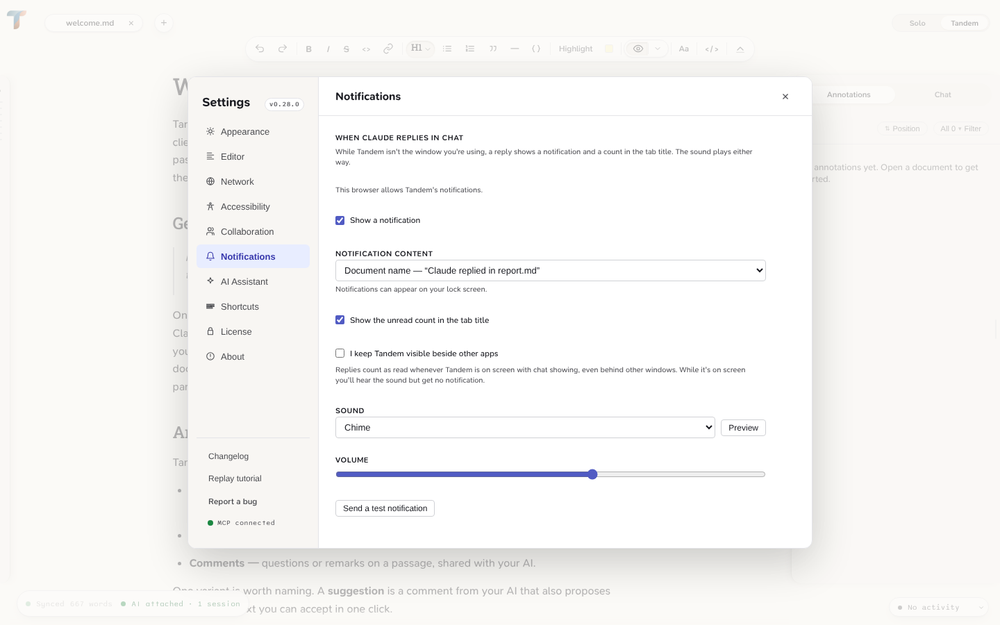

Change any of this under **Settings → Notifications**:

- **Show a notification** — on by default. In the browser, notifications also need your browser's permission. Tandem asks only when you click **Allow notifications** in this tab, or turn the setting on. With it off, you still hear the sound, at the same limit of once every 30 seconds while you're away.
- **Notification content** — what the notification says: *Generic* ("Claude replied"), *Document name* (the default, "Claude replied in report.md"), or *Message preview* (adds the start of the reply). Notifications can appear on your lock screen, so the reply text is off unless you choose it.
- **Flash the taskbar icon until you switch to Tandem** (desktop) / **Show the unread count in the tab title** (browser).
- **I keep Tandem visible beside other apps** — off by default. When it's on, replies count as read whenever Tandem is open on screen with chat showing, even behind other windows, and Tandem treats that window as the one you're using: you hear the sound but get no notification, flash or title count while it's on screen.
- **Sound** — Chime, Bell, Pop, Ping or None, with a **Preview** button and a volume slider.
- **Send a test notification** — check that notifications reach you. Clicking the test notification only brings Tandem forward.

In the browser, a reply that arrives before your first click or keypress in the Tandem tab plays no sound, because browsers block audio until you interact with the page; the notification and the title count still appear. In the desktop app, whether notifications appear at all is up to your operating system's notification settings, such as Focus Assist or Do Not Disturb. A desktop app hidden to the tray has no taskbar icon to flash, so you get the notification and sound only. If several Tandem windows are open, the one you're using plays the sound; with **I keep Tandem visible beside other apps** on, every window that counts as in use plays it, so two visible windows both chime. A window you're not using stays quiet once the reply has been read in another window.

## Settings

Everything lives in one modal, opened with `Ctrl+,` or from the brand menu:

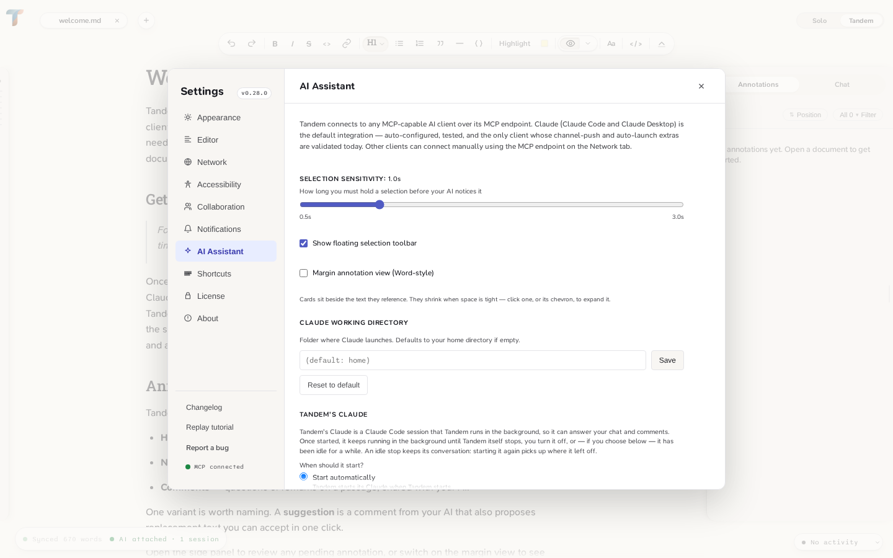

| Tab | What's in it |
|-----|--------------|
| **Appearance** | Theme (Light / Warm / Dark / System, plus **Use Warm when system is light**), which panel opens by default, text size, accent hue, spacing density, which decorations are shown (authorship, comments, highlights, notes), reduce motion, the optional formatting bar, reveal-rails-on-hover, uniform tab width, and the scroll pill |
| **Editor** | Reading measure, editor font, default font by file type, default save folder, smart typography, spellcheck, raw-markdown view, and source-view line wrap — see [Editor settings](#editor-settings) below |
| **Network** | Connection details, start-at-login (desktop app only), **Restart server**, and an **Advanced** section with the port, **Show degraded banner after** (how long the connection can be down before the [connection banner](#server-unavailable-or-weve-lost-the-connection-to-the-tandem-server) appears), the reconnect strategy and token rotation |
| **Accessibility** | High contrast, and pattern fills for annotations (**Reduce motion** lives under Appearance) |
| **Collaboration** | Your display name, and whether the side panel hides itself in Solo mode |
| **Notifications** | Reply notifications, what they say, the taskbar flash or tab-title count, whether a visible Tandem window counts as the one you're using (**I keep Tandem visible beside other apps**), and the reply sound and its volume — see [Reply Notifications](#reply-notifications) |
| **AI Assistant** | **Selection Sensitivity**, **Show floating selection toolbar**, the margin annotation view, **Claude working directory**, **Tandem's Claude** (when it starts and how long it runs), **Real-time updates** (how a session you started yourself hears about your comments as they happen, including the Tandem plugin's install commands with a Copy button), and the integration wizard — see [AI Assistant settings](#ai-assistant-settings) below |
| **Shortcuts** | A **Customizable** section with click-to-record remapping (20 app-level shortcuts), per-row reset and a reset-all, followed by read-only **(fixed)** sections — text formatting, undo/redo, heading levels, tab jumps and the help key are not remappable |
| **License** | License status — this version of Tandem doesn't require a license — and a field to activate a key you've been sent |
| **About** | **View Documentation**, version details, **Copy Diagnostics**, and **Open Log Folder** (desktop app only) |

### Editor settings

Most of what shapes the reading surface lives here.

- **Reading measure** — The line length of the text: Narrow (58 characters), Comfortable (68), Wide (82), or Full (fills the editor). A fixed measure keeps lines readable no matter which panels are open. The formatting bar's **Display** menu sets it too.
- **Editor font** — Sans-serif, Serif, or Monospace for the document text.
- **Default font by file type** — Overrides the editor font per format (`.md`, `.html`, `.txt`). Anything you don't set falls back to the editor font; **Reset to defaults** clears every override at once.
- **Default save folder** — Where **Save As** puts new files. Leave it empty to fall back to your AI's working directory, then your home folder. In the desktop app a **Choose…** button opens a native folder picker; in the browser you type the path, and browser Save As is a download that ignores this setting.
- **Smart typography** — Converts straight quotes, dashes, and `...` to typographic characters as you type. Opt-in.
- **Spellcheck** — Shows the browser's spelling underlines. On by default; turn it off here.
- **Show raw markdown** — Reveals footnotes, reference-style links, and inline HTML that Tandem keeps as raw source. When hidden they stay in the file and always save; only the on-screen markers are hidden. (This control used to sit under Appearance.)
- **Wrap long lines in Markdown source** — In the Markdown source view (`Ctrl+Shift+E`), long paragraphs wrap to the width of the view instead of scrolling sideways. Off by default; the file itself is unchanged either way.

### AI Assistant settings

- **Selection Sensitivity** — How long you must hold a selection still before your AI notices it, from 0.5 to 3 seconds (1 second by default).
- **Show floating selection toolbar** — The [selection popup](#selection-popup) that appears over selected text. On by default. With it off, `Ctrl+Alt+M` (comment on selection) also stops working, and Tandem tells you so when you press it.
- **Margin annotation view (Word-style)** — Shows annotation cards beside the text they refer to; see [Keyboard Review](#keyboard-review).
- **Claude working directory** — The folder Claude launches in. Empty means your home folder. Type a path and click **Save**, use **Choose folder…** in the desktop app, or **Reset to default**.
- **Tandem's Claude** — the Claude Code session Tandem runs in the background to answer your chat and comments (see [Tandem's Claude in chat](#tandems-claude-in-chat)):
  - *When should it start?* **Start automatically** (the default — when Tandem starts), **Wait until I click Start** (from the status bar or the chat panel), or **Off** (Tandem doesn't run its own Claude; choosing Off stops it now).
  - *How long should it run?* **Keep it running in the background** (the default), or **Stop it when it has been idle** for a number of minutes you choose (30 by default, 1 to 1440). The idle time counts from the end of its last turn, so it never stops in the middle of one, and an idle stop keeps its conversation for the next start.
- **Real-time updates** — How a Claude Code session you started yourself hears about your comments as they happen. See [Real-Time Push](#real-time-push-recommended).
- **Open integration wizard…** / **Reopen integration wizard…** — Connect Claude Code or Claude Desktop.

The Claude working directory, Tandem's Claude and Real-time updates sections appear once Claude Code has been set up through the wizard; until then the tab shows **No AI connected yet** with a **Connect AI…** button.

### Below the settings list

The bottom of the settings sidebar holds a few links that aren't settings:

- **Changelog** — Opens the release notes, read-only.
- **View license** — Opens Tandem's licence text (desktop app).
- **Replay tutorial** — Reopens `welcome.md` and runs the first-launch tutorial again.
- **Report a bug** — Opens a new GitHub issue in your browser, with diagnostics filled in where Tandem can gather them.
- **Connection status** — A dot and label for the editor's connection to the Tandem server: **MCP connected**, **Reconnecting…** or **MCP offline**. (It doesn't tell you whether an AI is connected; the status bar does.)

If your settings were saved by a newer version of Tandem, a banner at the top of the modal says "Settings are read-only — they were saved by a newer version of Tandem. Changes are disabled to protect them." The controls still show your settings, but you can't change them in this version.

## Keyboard Shortcuts

Press `?` to open the in-app shortcuts reference at any time — it always reflects your effective bindings. Twenty app-level shortcuts are remappable in **Settings → Shortcuts** (click-to-record); the rest — including text formatting, undo/redo, heading levels, find, tab switching and `?` itself — are fixed. The defaults are listed below.

### Editor

| Shortcut | Action |
|----------|--------|
| `Ctrl+B` | Bold |
| `Ctrl+I` | Italic |
| `Ctrl+Z` | Undo |
| `Ctrl+Y` | Redo |
| `Ctrl+S` | Save document |
| `Ctrl+Shift+S` | Save As (e.g. promote a scratchpad to a file) |
| `Ctrl+Alt+1`–`Ctrl+Alt+6` | Heading 1–6 |
| `Ctrl+Shift+V` | Paste as plain text |
| `Ctrl+F` | Find / replace |
| `Ctrl+Shift+F` | Find in open tabs |
| `Ctrl+G` | Find next match |
| `Ctrl+Shift+G` | Find previous match |
| `Alt+L` | Select containing block |
| `Ctrl+Shift+E` | View / exit Markdown source |

> **Note:** Undo and redo run off the CRDT's own undo history rather than the editor's, so they work while you and your AI are both in the document. The persistent formatting bar has buttons for both, and the desktop app's document right-click menu offers them too.

### Annotations & Review

| Shortcut | Action |
|----------|--------|
| `Ctrl+Enter` | Accept selected (or first pending) annotation |
| `Ctrl+Shift+Enter` | Dismiss selected (or first pending) annotation |
| `Alt+]` | Next annotation |
| `Alt+[` | Previous annotation |
| `Ctrl+Alt+M` | Comment on current selection |
| `Ctrl+Alt+A` | Toggle authorship colors |
| `Escape` | Deselect annotation / close overlays |

### Navigation & General

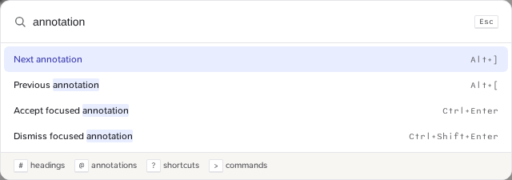

| Shortcut | Action |
|----------|--------|
| `Ctrl+Shift+P` | Command palette |
| `Ctrl+N` | New scratchpad |
| `Ctrl+O` | Open file |
| `Ctrl+T` | New-tab menu (recent files / browse) |
| `Ctrl+W` | Close tab |
| `Ctrl+Alt+T` | Reopen closed tab |
| `Ctrl+1`–`Ctrl+9` | Jump to tab 1–9 |
| `Ctrl+Tab` / `Ctrl+Shift+Tab` | Next / previous tab |
| `F2` | Rename the active tab's file |
| `Alt+Left` / `Alt+Right` | Reorder the focused tab |
| `Alt+Shift+Left` / `Alt+Shift+Right` | Toggle the outline panel / the Annotations + Chat panel |
| `Ctrl+Alt+F` | Show / hide the formatting bar |
| `Ctrl+Shift+M` | Toggle Solo / Tandem mode |
| `Ctrl+Shift+J` | Focus chat |
| `Ctrl+,` | Settings |
| `Enter` | Send message (chat panel) |
| `?` or `Ctrl+/` | Show/hide keyboard shortcuts |
| `Ctrl+=` / `Ctrl+-` / `Ctrl+0` | Zoom in / out / reset (desktop app; in a browser, its own zoom keys do the same) |

> **On Hungarian, Czech, Slovak, Croatian, Slovenian, Bosnian and Serbian (Latin) keyboards, `AltGr+F` types `[`.** Windows (and some Linux setups) report AltGr as `Ctrl+Alt`, so Tandem ignores `Ctrl+Alt+F` when the browser flags the press as AltGr. If `[` still toggles the formatting bar instead of typing, remap **Toggle formatting bar** in **Settings → Shortcuts**.

> **In the browser build, `Ctrl+N`, `Ctrl+T` and `Ctrl+W` belong to the browser** — it opens a window, opens a tab, or closes your Tandem tab before the page ever sees the key. Use the **+** button in the tab bar and the command palette (`Ctrl+Shift+P`) instead, or remap New Scratchpad, New tab menu and Close active tab in **Settings → Shortcuts**. The desktop app owns its own window, so all three work there.

## Working with Claude Code

Tandem connects to Claude Code through MCP (Model Context Protocol). Claude gets Tandem's full MCP tool surface for reading documents, creating annotations, searching text, managing files, and communicating with you.

### Connection

Start the Tandem server first (`tandem` for global install, or `npm run dev:standalone` for development). Then start Claude Code. Claude's tools become available via the MCP configuration written by the integration wizard (or `tandem setup --apply` for a scripted setup), or `.mcp.json` (development).

**Desktop app:** The server is already running. On first run the integration wizard configures Claude Code; once connected, your `tandem_*` tools are available immediately. You can re-open the wizard any time from the tray "Setup AI Assistant" item or Settings. Skip to [Real-Time Push](#real-time-push-recommended) if you want Claude to react to your comments and chat messages on its own, without waiting to be asked.

Claude can check the connection with `tandem_status`, which reports open documents, connection state, and your current mode (Solo or Tandem).

### Real-Time Push (Recommended)

Your chat messages, the comments and replies you write, and your accepts, dismisses and edits of annotations can push to Claude in real time rather than waiting for it to poll (in Solo, only chat messages are pushed — see [Solo / Tandem Mode](#solo--tandem-mode)). A text selection isn't pushed on its own; it travels with your next chat message. Sessions Tandem launches for you already get this and need no setup. In a session you start yourself, first Tandem use runs the bundled skill; on the first Tandem response that returns a wake-stream address — `tandem_open`, `tandem_scratchpad` or a read-mode `tandem_status` — the skill automatically arms one [built-in Monitor watch](glossary.md#wake-watch) using it. Claude Code ends each watch after at most 30 minutes, and the skill re-arms it when that happens, which costs one short turn every 30 minutes while the session is idle.

The **built-in Monitor watch** needs no installation or flag and lasts only for that session. It requires a Claude Code account where Monitor is enabled and, on Windows, Git Bash. Asking Claude to watch is recovery if the automatic attempt was skipped or the watch ended (for example after Tandem restarted), not a required setup step.

The **Tandem plugin** also needs no flag — install it once and every `claude` you start afterwards picks it up, though it begins watching only when Claude first uses Tandem's skill in that session. Ask for Tandem by name and it starts; a session that has never heard of Tandem is not listening yet. Start `claude` from a terminal, since its [plugin monitor](glossary.md#plugin-monitor) uses that session's program path to find Node.

The **channel flag** is the third route. It drives the [channel shim](glossary.md#channel-shim), which is not registered by default: register it once with `tandem setup --apply --with-channel-shim` (the desktop app does not install the `tandem` command, so a desktop-only user needs the npm install for this; see [Troubleshooting](troubleshooting.md#i-sent-a-chat-message-or-left-a-comment-and-nothing-happened)). The flag itself must be present on every session:

```bash
claude --dangerously-load-development-channels server:tandem-channel
```

Choose one setup route where possible. A session with the plugin and built-in Monitor available may start both automatically on first Tandem use. Wakes carry no message content and the inbox de-duplicates what Claude reads, but the overlap can waste a turn; if doubled wakes make it visible, ask Claude to stop the built-in watch with `TaskStop`. The channel flag is Claude Code's marker for unstable APIs; it stays necessary for this transport regardless of how the Channels API matures, because the allowlist that would make it optional covers plugins only and `tandem-channel` is a plain MCP server. It also has no effect outside an interactive session.

### Polling Remains Authoritative

[Push](glossary.md#push-and-pull) wakes an idle Claude, but it can be dropped or rate-limited and never carries the message itself. Claude should keep calling `tandem_checkInbox` during active work. If no push route is available and you want periodic checks while otherwise idle, use the `/loop` skill in Claude Code:

```
/loop 30s check tandem inbox and respond to any new messages
```

This polls every 30 seconds. Token cost is minimal when there are no new messages.

### The Communication Loop

Two tools form the core of how Claude and the user communicate:

- **`tandem_checkInbox`** — Claude calls this to see user actions: chat messages, annotation accepts/dismisses, text selections, and document switches. Returns everything since the last check.
- **`tandem_reply`** — Claude sends a chat message back to the user. Appears in the Chat panel.

Real-time push is a best-effort wake signal, not the authority on what Claude sees. Wakes can be dropped or rate-limited and carry no message content, so Claude still polls `tandem_checkInbox`; that inbox remains authoritative and de-duplicates items already pushed.

### Session Handoff

**What persists** across server restarts:
- Document content (Y.Doc state)
- All annotations (stored alongside Y.Doc in session files)
- File paths, formats, and metadata

**What doesn't persist:**
- Claude's awareness state (status text, focus paragraph)
- User awareness state (selection, typing indicator)

**How a new Claude session picks up:**
1. Call `tandem_status()` to see open documents
2. Call `tandem_listDocuments()` for details
3. Call `tandem_getOutline()` on the active document to orient
4. Call `tandem_getAnnotations()` to see existing annotation state
5. Continue where the previous session left off

Previously-open documents are auto-restored when the server starts — no manual `tandem_open` needed.

### Further Reading

- [MCP Tool Reference](mcp-tools.md) — Full documentation for all MCP tools
- [Workflows](workflows.md) — Advanced Claude Code patterns: cross-referencing documents, multi-model collaboration, RFP drafting, session handoff details
- [Architecture](architecture.md) — System design, coordinate systems, data flows

## Troubleshooting

### "Server unavailable" or "We've lost the connection to the Tandem server"

The editor can't reach the Tandem server. Two messages say so:

- **With no document open**, after 3 seconds the empty editor shows **Server unavailable**: "Tandem can't reach its sync server. Make sure it's running locally.", with **Retry** and **Open settings**.
- **Whether or not a document is open**, a banner across the top says "We've lost the connection to the Tandem server. Please check that it's still running.", with **Retry now**. It appears once the connection has been down for 30 seconds; change that under **Settings → Network → Advanced → Show degraded banner after** (5 to 120 seconds). Dismiss it with its ×; it comes back the next time the connection drops. Meanwhile the status bar shows the reconnect attempts, and Tandem keeps retrying on its own.

Make sure the server is running:
- **Desktop app:** check the system tray — see [Desktop app: server won't start](#desktop-app-server-wont-start)
- **Global install:** Run `tandem` in a terminal
- **Development:** Run `npm run dev:standalone`

If the server was restarted, refresh the page.

### Annotations not appearing

Check the connection indicator in the status bar. If it shows "Reconnecting...", the WebSocket connection dropped — it will auto-reconnect.

If connected but annotations still aren't showing, check your **mode** in the title bar. **Solo** does not hide anything Claude creates, but it does hide the right rail by default, and Claude is asked to hold off on new annotations while you are in it — so the usual symptom is "nothing new is arriving". Switch to **Tandem** and the comments you wrote in Solo are released to Claude at the same time.

If the annotations are there but anchored to the wrong text, that is a re-anchoring problem rather than a sync one — **Settings → About → Copy Diagnostics** and [file an issue](https://github.com/bloknayrb/tandem/issues) with the report attached.

### Document won't load

Verify the file path exists and is readable. The server logs (terminal where you started Tandem) will show errors for missing files or permission issues.

### Claude isn't responding

If you sent a chat message or left a comment and Claude did nothing, start with [I sent a chat message (or left a comment) and nothing happened](troubleshooting.md#i-sent-a-chat-message-or-left-a-comment-and-nothing-happened): it explains what the status bar's AI label means and walks through the real-time routes.

Make sure Claude Code is running and connected. Check `tandem_status` from Claude Code — if it returns an error, Claude can't reach the server. Run `/mcp` in Claude Code to reconnect.

If using channels, the server must be running before Claude Code starts. If you restarted the server, restart Claude Code or run `/mcp`. Channel timeout messages such as `/api/events timed out after 10000ms`, `SSE inactivity timeout`, or `/api/channel-reply timed out after 5000ms` mean the server accepted a connection but stopped responding; restart Tandem and reconnect Claude.

For server-side and MCP troubleshooting, see [troubleshooting.md](troubleshooting.md).

### Desktop app: server won't start

The desktop app runs the server as a background sidecar process. Check the system tray — if Tandem's icon is there, the server is running. If the icon is missing or the app shows an error dialog, the sidecar failed to start (port conflict, missing resources, or crash). The error dialog offers **Retry Server Start**; Settings → Network → **Restart server** does the same thing later. For persistent issues, open **Settings → About → Open Log Folder** and read `tandem.log` — see [troubleshooting → Reading server logs](troubleshooting.md#reading-server-logs).

## Related

- [Using Tandem map](maps/using-tandem.md): everything else about writing and reviewing in Tandem.
- [Workflows](workflows.md): worked examples of a review, a multi-document check and a draft, with the MCP calls Claude makes.
- [Troubleshooting](troubleshooting.md): the full list of problems and fixes, beyond the short one above.
- [Configuration](configuration.md): environment variables, the app-data folders and start at login.
- [Integrations](integrations.md): connecting an AI client other than Claude Code.
- [MCP tool reference](mcp-tools.md): every tool Claude can call on your documents.
- [Glossary](glossary.md): Solo mode, notes, suggestions and the other terms this guide uses.
- [ADR-027](decisions.md#adr-027-annotation-system-redesign--audience-based-model): why notes stay private from the AI.
